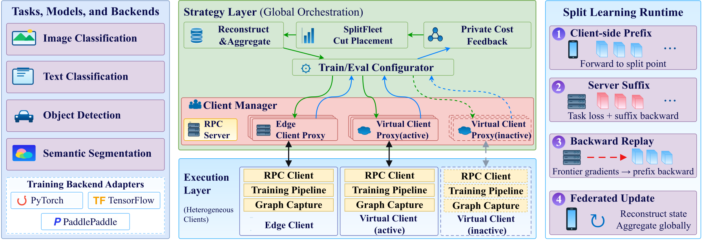

# SplitFleet

**A Unified Framework for Resource-Adaptive Split Federated Learning**

SplitFleet is a research framework for collaborative training across edge devices with heterogeneous compute, memory, and network resources. It combines automatic operation-level model partitioning with measured, per-client cut placement, built on Flower orchestration and TorchLens split execution.

Each client runs a model prefix locally and offloads the remaining suffix to a server. SplitFleet exchanges the complete boundary frontier, propagates gradients back to the client, and reconstructs each client's complete model update before federated aggregation. Clients can use different cuts while training the same logical global model.

[Overview](#overview) · [Paper results](#paper-results) · [Installation](#installation) · [Quickstart](#quickstart) · [Adaptive placement](#adaptive-placement) · [Repository guide](#repository-guide)

## Overview

- **Fine-grained split training.** Discover operation-level cuts from captured execution graphs and preserve cross-cut dependencies in models with residual connections, branches, and multiple inputs or outputs.
- **Explicit training admission.** Check replay, gradient propagation, state ownership, and boundary compatibility before using a cut for training. Boundary contracts identify the graph, cut, backend, tensor schema, and batch window.
- **Resource-adaptive placement.** Calibrate computation and communication costs, choose the lowest predicted local-round cost independently for each client, and update estimates from runtime feedback.
- **Complete federated updates.** Maintain independent server-suffix replicas and optimizer state per client, reconstruct prefix-owned and suffix-owned state, and aggregate successful updates by sample count.
- **Reusable task and backend interfaces.** Separate model execution, task losses, dataset integration, cut placement, and aggregation. Backend adapters cover PyTorch, TensorFlow, and PaddlePaddle.

### Training workflow



*Figure 2: SplitFleet architecture, from task and backend interfaces to global orchestration and the split-training runtime.*

A frontier contains every tensor needed across a cut, including dependencies that bypass the immediately preceding operation. The server computes the task loss and suffix backward pass; the client uses returned frontier gradients to complete prefix backpropagation. At the end of local training, the framework reconstructs each successful client's full update according to state ownership. If a round has no complete successful updates, it retains the previous global model.

### Tasks, models, and backends

| Task interface | Representative architectures studied in the manuscript |
| --- | --- |
| Image classification | ResNet-50, MobileNetV3-Large |
| Text classification | BERT-base, DistilBERT |
| Object detection | RF-DETR Nano, YOLO26n |
| Semantic segmentation | DeepLabV3-ResNet50 |
| Instance segmentation | Additional task adapter and synthetic validation fixtures |

The seven-architecture study uses the PyTorch execution path. TensorFlow and PaddlePaddle are evaluated separately with ResNet-50 on physical clients. Instance segmentation is an API capability; it is outside the manuscript's four-task performance evaluation. Executable cuts depend on the model, backend, input shape, and training-admission checks.

## Paper results

The companion manuscript evaluates a primary testbed of **three Jetson Orin devices and an RTX A6000 server**. The table summarizes two separate protocols from Section 6.2: mean training-time reduction over ten synchronous rounds, and model quality under a common wall-clock budget.

| Workload | Ten-round time reduction vs. FedAvg | Time budget | SplitFleet quality at the deadline |
| --- | ---: | ---: | ---: |
| ResNet-50 / CIFAR-10 | 35.3% | 300 s | 56.80% accuracy |
| BERT-base / AG News | 43.9% | 500 s | 88.44% macro-F1 |
| RF-DETR Nano / VOC2007 | 56.5% | 500 s | 89.63% mAP@0.5 |
| DeepLabV3-ResNet50 / Oxford-IIIT Pet | 73.0% | 600 s | 77.44% mIoU |

Both protocols use five paired seeds. The ten-round comparison uses 240 training and 200 test examples per task, with matched initialization, partitions, and training settings within each seed. In the time-budget comparison, SplitFleet has the highest mean quality among the eight evaluated methods on image classification, text classification, and semantic segmentation; RF-DETR Nano is competitive with FedCompass and Fixed-75. These measurements describe the manuscript's workloads and experimental settings.

Additional experiments in Section 6.3 report:

- **100 virtual clients:** 50 synchronous ResNet-50/CIFAR-10 rounds on one H100 host, using 16 CPU workers and GPU suffix execution. All clients participate each round, with 45,000 training and 5,000 test examples. Final test accuracy is 93.76% for SplitFleet and 93.64% for FedAvg.
- **Physical multi-backend training:** TensorFlow and PaddlePaddle each complete 50 rounds of ResNet-50/CIFAR-10 training from scratch with six CPU/GPU client instances across three Orins and an A6000 server. Final independent test accuracies are 74.20% and 76.86%, respectively.

These are reported paper results. The public snapshot contains the framework and synthetic validation code; the experiment launchers, datasets, raw measurements, and manuscript artifacts needed to reproduce the paper's complete evaluation are outside this release.

## Installation

Use **Python 3.11**. The project pins **Flower 1.40.0** and **TorchLens 2.34.1**, and requires **PyTorch >= 2.11.0**. See [pyproject.toml](pyproject.toml) for the dependency declarations.

The recommended installation uses `uv` and the repository lockfile. The `experiment` extra supplies torchvision for the ResNet-50 examples below:

```bash
git clone https://github.com/SplitFleet-sys/SplitFleet.git
cd SplitFleet
uv sync --python 3.11 --extra experiment
```

The [bundled TorchLens wheel](torchlens-2.34.1-py3-none-any.whl) is selected by `tool.uv.sources` and recorded in [uv.lock](uv.lock). Keep it in place: the runtime checks the exact TorchLens version and uses its split-training API.

Verify the selected versions:

```bash
uv run python -c "from importlib.metadata import version; print({p: version(p) for p in ('splitfleet', 'torchlens', 'flwr')})"
```

Optional backend dependencies can be installed with the corresponding extra:

```bash
uv sync --python 3.11 --extra tensorflow
```

Other extras include `paddle`, `multibackend`, `integration` for model integrations, and `simulation` for Flower/Ray dependencies. GPU deployments also require backend builds appropriate to the device and CUDA environment.

## Quickstart

### Run a local split-training step

Save the following as `quickstart.py`. It uses torchvision's ResNet-50 with a ten-class head and the public `AutoSplitSession` API to run the prefix forward pass, suffix loss and backward pass, and prefix backward pass on the CPU. Synthetic RGB images keep this API example self-contained; `weights=None` initializes the standard architecture without downloading pretrained weights.

```python
import torch
from torch import nn
from torchvision.models import resnet50

from splitfleet.autosplit import AutoSplitSession

torch.manual_seed(7)
model = resnet50(weights=None, num_classes=10).train()
sample_inputs = torch.randn(2, 3, 224, 224)
targets = torch.tensor([0, 1])

session = AutoSplitSession(device="cpu")
runtime = session.prepare_runtime(
    model,
    sample_inputs,
    boundary="50%",
    trainable=True,
    dynamic_batch=(2, 8),
)

optimizer = torch.optim.SGD(model.parameters(), lr=0.01)
result = session.run_train(
    runtime,
    sample_inputs,
    targets,
    loss_fn=nn.CrossEntropyLoss(),
    prefix_optimizer=optimizer,
    suffix_optimizer=optimizer,
)

print(f"boundary={runtime.plan.boundary}")
print(f"loss={result['loss'].detach().item():.6f}")
```

```bash
uv run --extra experiment python quickstart.py
```

This is one split-training step in a single process. A federated deployment additionally needs client data loaders, independent client/server model replicas, RPC connections, and round orchestration. The shared stateless SGD optimizer above is suitable for this local example; distributed stages and clients maintain their own optimizer state.

### Validate split execution

The validation CLI is included in this repository and downloads no datasets or pretrained weights:

```bash
uv run python -m splitfleet.validation --backends torch --tasks image_classification --output results/validation-image.json
```

To check every enumerated boundary of the synthetic fixtures for all five task families:

```bash
uv run python -m splitfleet.validation --backends torch --all-nodes --output results/validation-all.json
```

Reports compare model outputs, task losses, all parameter gradients, and one SGD update against native execution, including activation and boundary-gradient serialization round trips. The default samples up to four boundaries per task; `--all-nodes` checks every enumerated before/after boundary. Exit codes are `0` for passed, `1` for failed, and `2` for partial or unsupported results. These fixtures check synthetic task correctness; they do not reproduce the paper's model-quality or convergence experiments. The CLI currently accepts the PyTorch backend only.

## Adaptive placement

`GreedyPlacementPolicy` is the measured adaptive policy provided by the framework. For client `i` and candidate cut `c`, its cost model is:

```text
predicted_round_cost(i, c) = local_batches(i) * (
    client_compute(i, c) + server_compute(i, c) + boundary_rpc(i, c)
) + model_state_exchange(i, c)
```

Computation and boundary communication are charged per local batch; model-state exchange is charged once per round. Calibration measures admitted structural anchors and restores training state afterward. Successful training feedback updates each client's cost estimates; failed executions affect feasibility and cooldown without becoming latency samples. A client's chosen cut stays fixed for that local round.

To configure the policy, reuse the imports and sample batch from the quickstart with a fresh ResNet-50 model:

```python
from splitfleet.server.placement import (
    GreedyConfig,
    GreedyPlacementPolicy,
    TorchLensCandidateProvider,
)
from splitfleet.server.strategy import AutoSplitStrategy
from splitfleet.tasks import ImageClassificationTask, ModelInputs, TaskBatch

model = resnet50(weights=None, num_classes=10)
sample_batch = TaskBatch(ModelInputs.from_value(sample_inputs), targets)
placement = GreedyPlacementPolicy(
    candidate_provider=TorchLensCandidateProvider(
        model=model,
        sample_inputs=sample_batch.inputs,
    ),
    config=GreedyConfig(server_concurrency=1),
)

strategy = AutoSplitStrategy(
    model=model,
    sample_inputs=sample_batch,
    task=ImageClassificationTask(),
    placement_policy=placement,
    aggregation_policy="splitfed",
    optimizer_fn=lambda module: torch.optim.SGD(module.parameters(), lr=0.01),
    min_fit_clients=2,
    min_evaluate_clients=2,
    min_available_clients=2,
)
```

This constructs a strategy; it does not start a distributed job. Integrate it with [start_server](splitfleet/server/app.py) and construct clients with [AutoSplitSplitLearningClient](splitfleet/client/autosplit_split_client.py), matching their task, model, calibration batch, and optimizer configuration. The strategy uses a fixed `boundary="50%"` when no placement policy is supplied; pass a policy explicitly to enable adaptive selection.

The default policy configuration uses one suffix execution slot (`C=1`) while retaining independent per-client suffix replicas. Increasing `server_concurrency` changes execution capacity on the server, not the number of GPUs. Cut selection minimizes each client's predicted cost independently; shared-server queueing and joint multi-client placement are outside the current scoring model.

## Repository guide

| Path | Purpose |
| --- | --- |
| [splitfleet/autosplit/](splitfleet/autosplit) | Graph capture, cut planning, runtime sessions, boundary contracts, and serialization |
| [splitfleet/backends/](splitfleet/backends) | Backend adapters and common tensor/model operations |
| [splitfleet/tasks/](splitfleet/tasks) | Task adapters, metrics, and `TaskSpec` / `TaskRegistry` integration |
| [splitfleet/client/](splitfleet/client) | Client-prefix execution and RPC communication |
| [splitfleet/server/strategy/](splitfleet/server/strategy) | Split metadata, round configuration, reconstruction, and aggregation |
| [splitfleet/server/placement/greedy/](splitfleet/server/placement/greedy) | Candidate discovery, calibration, private cost tables, feasibility, and feedback |
| [splitfleet/server/stage_runtime/](splitfleet/server/stage_runtime) | Server-suffix runtime management |
| [splitfleet/runtime/](splitfleet/runtime) | Backend execution, auxiliary state, and prefix-context ownership |
| [splitfleet/split_engine/](splitfleet/split_engine) | Split-engine interfaces and graph/model contracts |
| [splitfleet/transport/](splitfleet/transport) | Activation, gradient, and tensor-bundle wire formats |
| [splitfleet/validation/](splitfleet/validation) | Synthetic task-equivalence CLI |
| [splitfleet/virtual/](splitfleet/virtual) | Flower/Ray virtual-client runtime source |
| [proto/](proto) | RPC protocol definitions |
| [dependency_patches/](dependency_patches) | Dependency patch notices and third-party license texts |

## Paper and attribution

The companion manuscript is titled **SplitFleet: A Unified Framework for Resource-Adaptive Split Federated Learning**. The results above refer to Sections 6.2 and 6.3. When referring to a specific implementation, reference [this repository](https://github.com/SplitFleet-sys/SplitFleet) and the commit you used.

SplitFleet builds on Flower for federated orchestration and TorchLens for graph capture and split execution, with project lineage from SplitBud. Notices for bundled or patched third-party components are collected in [dependency_patches/](dependency_patches).
